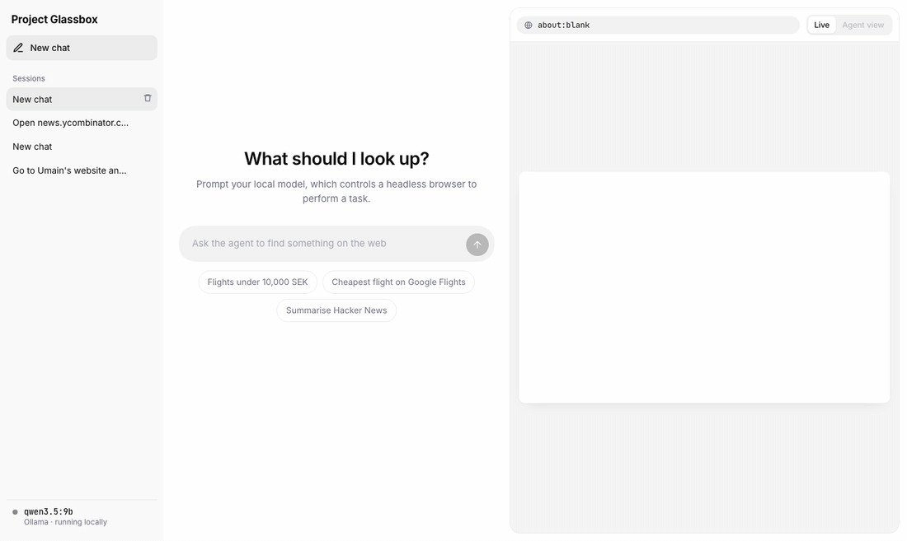
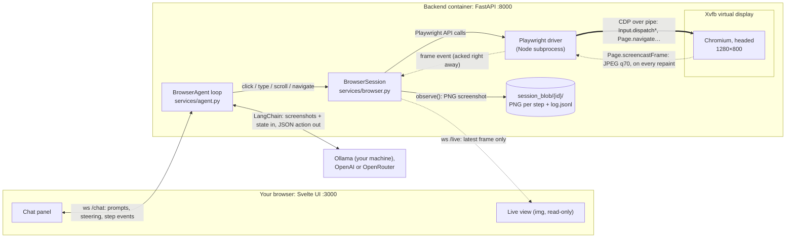
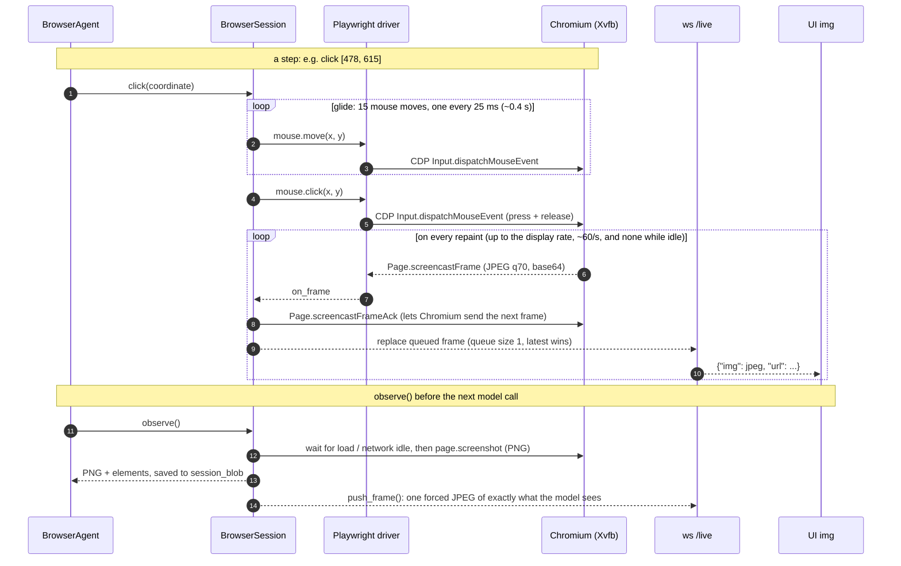

# Project Glassbox

**A browser agent you can watch and steer.** Give it a question. A vision model drives a sandboxed Chromium until it finds the answer, and you watch the browser live next to the chat.



## Features

- 🖥️ **Live view.** Watch the agent's browser in real time, cursor and all.
- 🧭 **Steerable.** Type while it works (e.g. " Please only direct flights") or stop it.
- 🔍 **Inspectable.** See the exact screenshot the model saw at each step and where it clicked.
- 🔒 **Sandboxed.** Each chat gets its own throwaway browser: none of your cookies or logins. It never logs in, buys or submits anything.
- 🏠 **Local by default.** Runs on Ollama on your machine. OpenAI and OpenRouter are optional.
- 📈 **Traceable.** Optional Langfuse tracing of every model call and action.

**Contents:** [Quick start](#quick-start) · [Using it](#using-it) · [Configuration](#configuration) · [How it works](#how-it-works) · [API & errors](#api--errors) · [Glossary](#glossary)

## Quick start

Both ways need a model: [Ollama](https://ollama.com) with a vision model pulled, or an [OpenAI or OpenRouter key](#models). In both, the model chip in the sidebar turns green when the model is ready.

```bash
ollama serve                  # skip if the Ollama app is already running
ollama pull qwen3.5:9b        # ~7.6 GB vision model
cp .env.example .env          # optional: change the model, steps, etc.
```

### Runbook A: with Docker (recommended)

**You need:** Docker.

| Step | Command | Check |
|---|---|---|
| 1. Build and start | `docker compose up --build` | Logs show the backend on `:8000` and the frontend on `:3000` |
| 2. Open the UI | http://localhost:3000 | Model chip is green |
| 3. Stop | `Ctrl+C`, then `docker compose down` | |

Chromium runs headed inside the backend container (on Xvfb), and the container reaches Ollama on your machine through `host.docker.internal`. Nothing opens on your desktop.

### Runbook B: without Docker

**You need:** Python 3.12+ with [uv](https://docs.astral.sh/uv/), and Node.js with npm. Use two terminals.

| Step | Terminal | Command | Check |
|---|---|---|---|
| 1. Install the backend and Chromium (once) | 1 | `cd backend && uv sync && uv run playwright install chromium` | |
| 2. Start the backend | 1 | `uv run uvicorn app.main:app --reload --port 8000` | http://localhost:8000/api/docs loads |
| 3. Install and start the frontend | 2 | `cd frontend && npm install && npm run dev` | Vite prints http://localhost:5173 |
| 4. Open the UI | | http://localhost:5173 (it proxies `/api` to `:8000`) | Model chip is green |
| 5. Stop | both | `Ctrl+C` | |

The backend reaches Ollama at `OLLAMA_BASE_URL` (default `http://localhost:11434`). Chromium is headless by default. Set `HEADLESS=false` in `.env` to watch its window. It's still a separate sandbox browser, not your own. `--reload` restarts the backend when you edit its code, and Vite hot-reloads the frontend.

### Troubleshooting

| Symptom | Fix |
|---|---|
| Model chip is red: Ollama unreachable | Start Ollama (`ollama serve`). In Docker, it's reached at `host.docker.internal:11434`, so Ollama must be running on your machine |
| Model chip is red: model not pulled | `ollama pull <OLLAMA_MODEL>`, or set `OLLAMA_MODEL` to one you have (`ollama list`) |
| Without Docker: Chromium fails to launch | Run `uv run playwright install chromium` again |
| Port 3000, 5173 or 8000 is in use | Stop whatever is using it, or change the port mapping in [docker-compose.yml](docker-compose.yml) |

## Using it

1. **Send a prompt**, or pick a suggestion:
   > Open skyscanner.se, find one-way flights from Stockholm to Chicago on 25 November and tell me my options below 10,000 SEK
2. **Watch.** The right panel shows the browser live. The chat shows each step: the action, the model's reasoning and how long it took.
3. **Inspect.** Click a step number or switch to **Agent view** to see the screenshot the model saw and where it pointed.
4. **Steer** while it runs ("try Google Flights instead"), or press **Stop**.
5. **Follow up** after it answers ("which one is fastest?"). The browser and the conversation carry over.
6. **New chat** starts another session with its own browser. Running agents keep going while you switch.

Every session's screenshots and a `log.jsonl` of its events are saved in `./session_blob/{session_id}/` (git-ignored).

## Configuration

All settings live in `.env` (see [.env.example](.env.example)).

| Variable | Default | What it does |
|---|---|---|
| `OLLAMA_MODEL` | `qwen3.5:9b` | Any Ollama vision model |
| `OLLAMA_THINK` | `false` | Thinking mode: better plans, much slower steps |
| `OPENAI_API_KEY` + `OPENAI_MODEL` | — | Set both to use OpenAI instead of Ollama |
| `OPENROUTER_API_KEY` + `OPENROUTER_MODEL` | — | Set both to use OpenRouter instead of Ollama (OpenAI wins if both pairs are set) |
| `MAX_STEPS` | `30` | Steps before the agent gives up |
| `HISTORY_MESSAGES` / `HISTORY_IMAGES` | `10` / `3` | How much history the model sees, and how many past screenshots. `HISTORY_IMAGES=0` is text-only mode |
| `HEADLESS` | `true` | Runbook B only. `false` opens the sandbox window (Docker is always headed) |
| `LANGFUSE_*` | — | Turns on tracing |

### Models

**Ollama** (local) is the default. `qwen3.5:9b` is a good balance, at about 10–25 s per step on an M-series Mac.

**OpenAI:** set both `OPENAI_API_KEY` and `OPENAI_MODEL`. Any vision model with structured outputs works.

**OpenRouter:** set both `OPENROUTER_API_KEY` and `OPENROUTER_MODEL` to an OpenRouter model id, e.g. `qwen/qwen3-vl-32b-instruct`. One key for any model (Qwen, Gemini, Claude, GPT, …); it speaks the OpenAI API, so it's the same client with a different base URL. Pick a model that takes images and supports structured outputs ([filtered list](https://openrouter.ai/models?modality=image&supported_parameters=structured_outputs)).

**Text-only models** (e.g. `inception/mercury-3`) work with `HISTORY_IMAGES=0`: the model never sees a screenshot and navigates from the element list (labels + positions) alone. Expect weaker results on visually dense pages.

With a cloud provider, screenshots of the sites the agent visits go to it. The prompt and inputs are otherwise identical, so runs are comparable.

### Tracing with Langfuse

Set `LANGFUSE_PUBLIC_KEY`, `LANGFUSE_SECRET_KEY` and `LANGFUSE_BASE_URL`, then restart. Each task becomes one trace, grouped by chat session and tagged with the provider and model:

```
task                prompt in, final answer out
  step 1
    decide          the exact messages + screenshots sent, raw reply, latency
    click           the browser action and its outcome (ERROR if it failed)
  step 2 ...
```

Without the keys, tracing is off and nothing leaves your machine.

## How it works

### Architecture



Solid arrows are commands, dotted arrows are frames.

### The agent loop

`BrowserAgent.run` in [agent.py](backend/app/services/agent.py) is the whole loop and reads top to bottom. Each step:

1. **`read_user_messages()`** picks up anything you typed (steering).
2. **`observe()`** waits for the page to settle, then takes a screenshot and lists the interactive elements on screen, plus the URL, title and how far down the page it is.
3. **`decide()`** makes one model call ([llm.py](backend/app/services/llm.py)) with your task, recent history and the current state. The reply is forced into one JSON object ([schema](backend/app/schemas/agent.py)):
   ```json
   {"thought": "Search box is at the top", "action": "type", "coordinate": [478, 615], "text": "Chicago O'Hare"}
   ```
4. **`act()`** runs browser actions (`navigate`, `click`, `type`, `key`, `scroll`, `back`, `wait`) with Playwright. **`respond()`** handles `message` (talk to you, keep working) and `done` (final answer).

When the task ends, `give_up()` runs if it hit `MAX_STEPS`, and `remember()` keeps the conversation for follow-ups. Everything the model reads is in [prompts.py](backend/app/services/prompts.py).

### Design choices

- **What the model sees: screenshots and elements, no page text.** It can only read what's on screen, like a person. Each step also says how much of the page is visible (`Visible: 0–3% of the page, 39.1 screens tall`), so it knows how far to scroll.
- **Coordinates on a 0–1000 grid**, the space Qwen-VL models are trained to point in ([cookbook](https://github.com/QwenLM/Qwen3-VL/blob/main/cookbooks/2d_grounding.ipynb)), scaled to the 1280×800 viewport.
- **Headed, not headless.** Sites flag headless browsers as bots more often, so in Docker Chromium runs headed on a virtual display (Xvfb). Nothing opens on your machine.
- **The live view is images, not a browser.** Websites never load in your browser, and the view takes no input.
- **Loop guards for small models.** Past thoughts aren't fed back, since small models copy them. A repeated action triggers a warning, and a repeated `message` ends the task.

### Live view: commands in, frames out

Commands and frames share one channel: Python → Playwright's Node driver → CDP over a pipe → Chromium. At session start, [browser.py](backend/app/services/browser.py) calls `Page.startScreencast`, and from then on Chromium pushes a JPEG on every repaint.

- **Driven by repaints, not a timer.** Up to ~60 frames/s during navigation, mouse glides, scrolls and typing. Almost none on a still page.
- **Ack-gated.** Chromium waits for each frame's ack before sending the next. The backend acks right away, so a slow viewer never slows Chromium.
- **Latest frame wins.** Each viewer has a 1-slot queue: a slow connection skips frames but always ends on the current page.
- **One guaranteed frame per step.** `observe()` also pushes the exact screenshot the model is about to see.

<details>
<summary>Sequence diagram: one step, with timings</summary>



</details>

### Project layout

```
backend/app/
  main.py               FastAPI app, mounts /api/blob (screenshots)
  core/config.py        settings (.env)
  api/routes/           health, sessions (list/create/delete, ws /chat, ws /live)
  schemas/              API + agent output models
  services/agent.py     BrowserAgent: the loop
  services/llm.py       the model: OpenAI or OpenRouter if configured, otherwise Ollama
  services/prompts.py   what the model reads
  services/browser.py   sandbox Chromium: observe, act, live screencast
  services/sessions.py  in-memory sessions + event log
  services/tracing.py   optional Langfuse tracing
frontend/src/
  App.svelte            layout + websockets
  lib/                  Sidebar, Chat, BrowserPanel, reduce.js (events → UI state)
```

## API & errors

**Docs:** Swagger UI at http://localhost:3000/api/docs, ReDoc at `/api/redoc`, raw spec at `/api/openapi.json`. The WebSocket protocols (`/chat`, `/live`) are described under `sessions`.

**Typed errors.** Every error has one shape, as an HTTP response or as an `error` event on the WebSocket. The UI shows `message` and `hint`, and `detail` on hover.

```json
{"code": "model_not_pulled", "message": "The model qwen3.5:9b isn't downloaded yet.",
 "hint": "Run `ollama pull qwen3.5:9b`, or set OLLAMA_MODEL in .env to a model you have.", "detail": null}
```

If the model can't run (Ollama down, model not pulled, OpenAI or OpenRouter rejecting the key or model), the task stops right away instead of retrying.

<details>
<summary>How errors are layered</summary>

| Layer | File | Role |
|---|---|---|
| Contract | [schemas/errors.py](backend/app/schemas/errors.py) | `ErrorCode` + `ErrorOut`, the wire shape |
| Domain | [core/errors.py](backend/app/core/errors.py) | one exception per error (`OllamaUnreachable`, `SessionNotFound`, …), no HTTP |
| HTTP | [api/errors.py](backend/app/api/errors.py) | maps each code to a status (404, 422, 502, 503, …). Validation errors, unknown routes and crashes also become `ErrorOut` |
| UI | [api.js](frontend/src/lib/api.js) | typed client, plus browser-only codes (`backend_unreachable`, `connection_lost`) |

</details>

## Glossary

- **CDP** (Chrome DevTools Protocol): Chromium's remote-control protocol. Playwright sends clicks and navigation over it, and it streams the screencast back.
- **Playwright**: browser-automation library. Python → Node driver → CDP → Chromium.
- **Screencast**: Chromium pushes a JPEG on every repaint. Each frame must be acked before the next is sent.
- **Xvfb**: virtual display, so a headed browser (one with a real window) can run in a container.
- **VLM**: vision-language model. It reads screenshots and replies with the next action.
